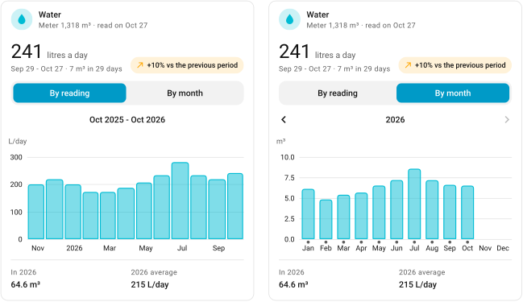

<p align="center">
  
</p>

<p align="center">
  
</p>

<p align="center">
  <strong>Your AcegasApsAmga water consumption in Home Assistant:<br>
  the whole reading history, the Energy Dashboard and a meter card.</strong>
</p>

<p align="center">
  <a href="https://github.com/fabioscarparo/HomeAssistant-AcegasApsAmga/releases/latest"></a>
  <a href="https://hacs.xyz/"></a>
  <a href="https://www.home-assistant.io/"></a>
  <a href="LICENSE"></a>
</p>

A custom [Home Assistant](https://www.home-assistant.io/) integration for
**AcegasApsAmga**, the Gruppo Hera utility of North-East Italy. It reads your
water meter readings from the **Servizi Online** portal and imports them as
long-term statistics, ready for the Energy Dashboard.

- **Energy Dashboard**: water consumption added with a single action.
- **Whole history**: every reading since the start of the contract, imported
  at setup.
- **Sensors**: meter reading, last period consumption, average daily
  consumption and next self-reading window.
- **Meter card**: average daily consumption of each reading period, monthly
  consumption and the year's totals.
- **Automatic updates**: new readings and corrections are picked up on their
  own.
- **Italian and English**, following each user's language.

<picture>
  <source media="(prefers-color-scheme: dark)" srcset="docs/images/contatore-card-dark.svg">
  
</picture>

> [!NOTE]
> Gas is planned: the code is ready, but it stays off until it can be tested
> with a real gas contract.

## Quick start

1. [Install](#installation) the integration with HACS and restart Home
   Assistant.
2. [Set it up](#setup) with your Servizi Online email and password.
3. [Add the water consumption](#energy-dashboard) to the Energy Dashboard with
   the **Configure Energy dashboard** action.

## Installation

### Requirements

- Home Assistant 2025.10 or later
- [HACS](https://hacs.xyz/)
- An account on the [AcegasApsAmga Servizi Online](https://servizionline.acegasapsamga.it/)
  with at least one water contract

### Install with HACS

The integration is not in the default HACS store yet: add it as a custom
repository.

1. Open **HACS**, then **⋮ → Custom repositories**.
2. Add `https://github.com/fabioscarparo/HomeAssistant-AcegasApsAmga` with
   type **Integration**.
3. Search for **AcegasApsAmga**, open it and select **Download**.
4. Restart Home Assistant.

### Manual installation

Copy `custom_components/acegasapsamga/` into the `custom_components/` folder of
your Home Assistant configuration, then restart Home Assistant.

## Setup

1. Go to **Settings → Devices & services → Add integration** and search for
   **AcegasApsAmga**, or open
   [this link](https://my.home-assistant.io/redirect/config_flow_start/?domain=acegasapsamga).
2. Enter the email and password of your **Servizi Online** account.
3. If the account has more than one water contract, choose the ones to follow.

Each contract becomes a device.

### Authentication

The password is stored in Home Assistant: portal sessions last at most one
day, so the integration signs in again on its own. If you change the password,
Home Assistant asks for the new one.

### Managing contracts

To add or remove contracts: **Settings → Devices & services → AcegasApsAmga →
Configure**. Removing a contract keeps the statistics already imported.

## Energy Dashboard

### Automatic configuration

Run the **AcegasApsAmga: Configure Energy dashboard** action, from **Developer
tools → Actions** or with
[this link](https://my.home-assistant.io/redirect/developer_call_service/?service=acegasapsamga.configura_energy_dashboard).
It adds the water consumption of every configured contract, and never changes
or duplicates sources that already exist.

### Manual configuration

Go to **Settings → Dashboards → Energy → Water consumption → Add water
source** and choose the statistic `acegasapsamga:<pod>_acqua`, where `<pod>`
is the supply point code shown on the device.

### How consumption is calculated

AcegasApsAmga reads water meters about **once a month**, in whole cubic
metres. A reading gives the consumption of a whole period, not of each day:
the integration spreads it evenly over the days between two real readings,
like the daily average on the portal.

- **Day and week views** show the average of the period, not a measured
  daily value.
- **The total between two readings** matches the meter exactly. A month's
  total is a share of the periods it overlaps, because readings rarely fall
  on the first of the month.
- **Only real readings count.** Estimated readings are billing estimates and
  are ignored.
- **A reading dated D includes day D**, as in the portal's billing periods.
- **The data ends with the last real reading**: nothing is projected. When
  the next reading arrives, the days in between are filled in.

The **Last reading date** sensor tells up to which day the Energy Dashboard
has data.

> [!NOTE]
> Costs are not supported yet: Home Assistant does not accept a price per m³
> on imported statistics.

## Sensors

Each contract is a device with these sensors:

| Sensor | Value |
|---|---|
| **Meter reading** | Last real reading, in m³ |
| **Last reading date** | Day of that reading: the Energy Dashboard has data up to here |
| **Last period consumption** | m³ from the day after the previous real reading to the day of the last one |
| **Average daily consumption** | Litres a day in that period |
| **Next self-reading** | First day of the next window to send a self-reading; the last day is in the attributes |

They have no state class on purpose: the Energy Dashboard reads the imported
statistics, where each reading falls on its own day.

## Meter card

The integration ships a card built around how AcegasApsAmga reads water
meters. It registers itself, with no Lovelace resource to add by hand: open a
dashboard, select **Edit dashboard → Add card** and search for
**AcegasApsAmga · Meter** (**AcegasApsAmga · Contatore** in Italian).

- **Litres a day** of the last reading period, with the change from the
  period before: a rise stands out at once, for example a leak or summer
  watering.
- **By reading**: one bar per period between two real readings, as wide as
  its days and as high as its daily average. It shows only what the meter
  measured.
- **By month**: cubic metres per month, year by year, as in the Energy
  Dashboard.
- **At the bottom**: the year's total and daily average.

Tap the header for the meter reading's details, or the main number for the
daily average's. The card follows the theme, light and dark mode, the language
and the number format of the user profile.

<details>
<summary>YAML configuration</summary>

```yaml
type: custom:acegasapsamga-contatore-card
device_id: <device id>   # optional: defaults to the first meter
name: Water              # optional
icon: mdi:water          # optional
view: readings           # readings | months
decimals: 2              # optional: 0 to 3, for values in m³
```

</details>

### Frontend cache

Right after installing or updating, the browser or the companion app can keep
the previous frontend. If the card is missing or shows *Custom element doesn't
exist*, reload the page (**Ctrl+Shift+R**, or **Cmd+Shift+R** on macOS) or
reset the companion app's frontend cache.

## Updates

The integration checks the portal every **6 hours**. When a new real reading
arrives, it recalculates the whole series, so corrections published by
AcegasApsAmga are applied too. If the portal does not answer, sensors and
statistics keep their values and the integration tries again after 30
minutes.

## Troubleshooting

### Sign-in errors

| Message | What to do |
|---|---|
| **Rejected the email or password** | Use the Servizi Online email and password, and check that they work on the website. |
| **Asks for another step** | Sign in once on the website and complete what it asks (new terms, password change), then try again. |
| **Cannot reach AcegasApsAmga** | Check Home Assistant's internet connection. |
| **Unexpected answer** | The portal may be under maintenance or may have changed. If it keeps happening, open an issue. |

### Reporting a problem

Open an [issue](https://github.com/fabioscarparo/HomeAssistant-AcegasApsAmga/issues)
with the message shown and the **diagnostics** file: **Settings → Devices &
services → AcegasApsAmga → ⋮ → Download diagnostics**. It contains no email,
password or token, and contract, supply point and meter codes are replaced by
`CONTRATTO_1`, `POD_1`... Do not attach screenshots with personal data.

## Languages

Entity names, setup, actions and errors follow each user's language, Italian
or English. Device models and statistic names follow the server language.

## Contributing

How the integration works inside, and how to check the sign-in against a real
account, is in [CONTRIBUTING.md](CONTRIBUTING.md).

## License

MIT, see [LICENSE](LICENSE).
