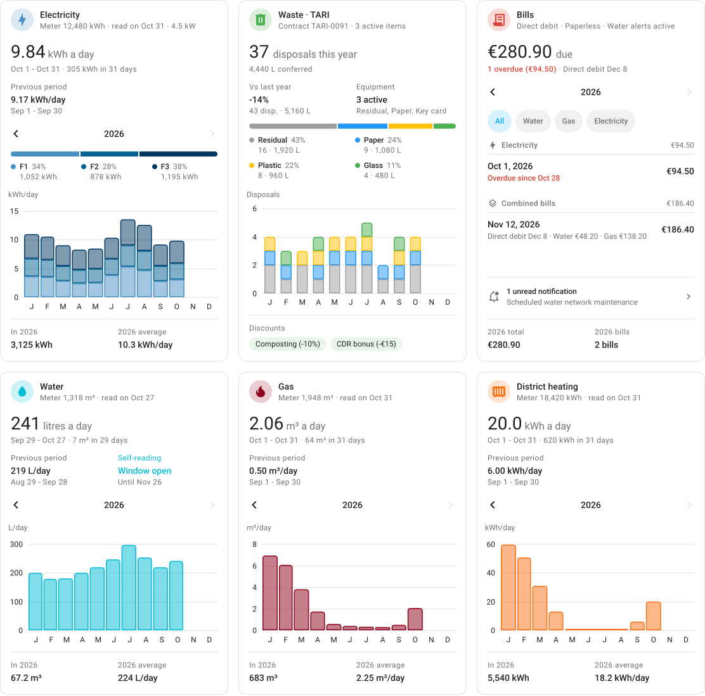

<p align="center">
  
</p>

<p align="center">
  
</p>

<p align="center">
  <strong>Your AcegasApsAmga utilities in Home Assistant:<br>
  water, gas, electricity, district heating, waste/TARI, Energy Dashboard, bills, calendar and dedicated cards.</strong>
</p>

<p align="center">
  <a href="https://github.com/fabioscarparo/HomeAssistant-AcegasApsAmga/releases/latest"></a>
  <a href="https://hacs.xyz/"></a>
  <a href="https://www.home-assistant.io/"></a>
  <a href="LICENSE"></a>
</p>

A custom [Home Assistant](https://www.home-assistant.io/) integration for
**AcegasApsAmga**, the Gruppo Hera utility of North-East Italy. It connects to
the **Servizi Online** portal and imports readings, consumption statistics,
bills, self-reading windows, waste disposals (TARI/TCP), notifications and
account alerts.

- **Multi-service support**: Water (`WATER`), Gas (`GAS`), Electricity
  (`ELECTRIC` with F1/F2/F3 time-of-use bands), District Heating (`HEATING`)
  and Waste/TARI (`ENVIRONMENT`).
- **Energy Dashboard**: water, gas and electricity grid consumption added with
  a single action.
- **Whole history**: every real reading since the start of the contract,
  imported at setup and updated incrementally.
- **Bills & payments**: amount due, due date, detailed portal status, actual
  payment dates, service splits on grouped bills, paperless flag and PDF
  download action.
- **Self-readings & Calendar**: countdown to the next window, native Home
  Assistant calendar entity for self-reading windows and bill due dates, and an
  action to submit self-readings directly from Home Assistant.
- **Account health**: 180-day password expiration diagnostic sensor with Repair
  Issues, new terms check, and unread portal notifications (including planned
  water outage alert status).
- **4 built-in Lovelace cards**: dedicated cards for Water/Gas/Heating meters,
  Electricity (F1/F2/F3), Waste/TARI, and cross-contract Bills & Account
  overview.
- **Italian and English**, following each user's language.

<picture>
  <source media="(prefers-color-scheme: dark)" srcset="docs/images/wall-dark.svg">
  
</picture>

## Quick start

1. [Install](#installation) the integration with HACS and restart Home
   Assistant.
2. [Set it up](#setup) with your Servizi Online email and password.
3. [Add consumption](#energy-dashboard) to the Energy Dashboard with the
   **Configure Energy dashboard** action.

## Installation

### Requirements

- Home Assistant 2025.10 or later
- [HACS](https://hacs.xyz/)
- An account on the [AcegasApsAmga Servizi Online](https://servizionline.acegasapsamga.it/)
  with at least one supported contract

### Install with HACS

The integration is not in the default HACS store yet: add it as a custom
repository.

1. Open **HACS**, then **⋮ -> Custom repositories**.
2. Add `https://github.com/fabioscarparo/HomeAssistant-AcegasApsAmga` with
   type **Integration**.
3. Search for **AcegasApsAmga**, open it and select **Download**.
4. Restart Home Assistant.

### Manual installation

Copy `custom_components/acegasapsamga/` into the `custom_components/` folder of
your Home Assistant configuration, then restart Home Assistant.

## Setup

1. Go to **Settings -> Devices & services -> Add integration** and search for
   **AcegasApsAmga**, or open
   [this link](https://my.home-assistant.io/redirect/config_flow_start/?domain=acegasapsamga).
2. Enter the email and password of your **Servizi Online** account.
3. If the account has more than one supported contract, choose the ones to
   follow.

Each contract becomes a device, alongside an account device for password
expiration and portal notifications.

### Authentication

The password is stored in Home Assistant: portal sessions last at most one
day, so the integration signs in again on its own. Portal passwords expire
every 180 days: Home Assistant raises a Repair Issue starting 15 days before
expiration so you can update your password before access stops working.

### Managing contracts

To add or remove contracts: **Settings -> Devices & services -> AcegasApsAmga
-> Configure**. Removing a contract cleans up its device and entities while
keeping previously imported statistics.

## Energy Dashboard

### Automatic configuration

Run the **AcegasApsAmga: Configure Energy dashboard** action, from **Developer
tools -> Actions** or with
[this link](https://my.home-assistant.io/redirect/developer_call_service/?service=acegasapsamga.configura_energy_dashboard).
It adds water, gas and electricity grid sources for every configured contract,
and never changes or duplicates sources that already exist.

### Manual configuration

Select the statistic `acegasapsamga:<pod>_acqua`, `acegasapsamga:<pod>_gas`,
or `acegasapsamga:<pod>_luce` in **Settings -> Dashboards -> Energy**.

### How consumption is calculated

AcegasApsAmga reads meters periodically (usually once a month). The integration
spreads each real period evenly over its hours, matching the portal's daily
average:

- **Only real readings count.** Estimated readings and rejected (`KO`) or
  pending (`IN_CHARGE`) self-readings are ignored.
- **A reading dated D includes day D**, matching the portal's billing periods.
- **The data ends with the last real reading**: nothing is projected.
- **Daily reads**: when the profile has `enabledDailyReads: true`, recent daily
  consumption rows are also exposed in the `consumi_giornalieri` attribute.

## Entities

### Metered contracts (Water, Gas, Electricity, District Heating)

| Entity | Value |
|---|---|
| **Meter reading** | Last real reading (`m³`, `kWh`, or `MWh`), with `fasce` (F1/F2/F3 for multi-band electricity), meter metadata and active VAS / Diario dei Consumi flags |
| **Last reading date** | Day of the last real reading |
| **Last period consumption** | Consumption between the last two real readings (plus `fasce` split and `periodi`) |
| **Average daily consumption** | `L/d` (water), `m³/d` (gas), `kWh/d` or `MWh/d` |
| **Next self-reading** | Start of the next window (`fine`, `aperta`, `giorni_mancanti`, self-reading history; disabled by default on smart/tele-read meters) |
| **Last bill** | Amount in EUR, detailed status, payment date, paperless flag, PDF availability and service split |
| **Amount due** | Residual left to pay on open bills |
| **Bill due date** | Earliest due date among unpaid bills |
| **Last bill status** | Unpaid, overdue, partly paid, paid, credit, reversed, installment... |
| **Calendar** | All upcoming self-reading windows and unpaid bill due dates |

### Waste / TARI contracts (`ENVIRONMENT`)

| Entity | Value |
|---|---|
| **Current year disposals** | Disposal count this year, with fraction split (`RSU`, `CARTA`, `VETRO`, `PLASTICA`, `ORGANICO`), monthly counts, previous year count and discounts |
| **Current year waste volume** | Total conferred volume in litres (and previous year volume) |
| **Active waste equipment** | Count and details of assigned bins, RFID cards and keys |
| **Bill sensors & Calendar** | TARI bills and due dates |

### Account device

| Entity | Value |
|---|---|
| **Password expiration** (diagnostic) | Portal password expiration date (`giorni_rimanenti`, `rinnovo_richiesto`, `nuove_condizioni_accettate`) |
| **Unread notifications** | Unread portal notifications count, latest notification and water outage alert (`WTR_FLT`) status |

## Actions

| Action | Description |
|---|---|
| `acegasapsamga.configura_energy_dashboard` | Adds water, gas and electricity statistics to the Energy Dashboard |
| `acegasapsamga.invia_autolettura` | Submits a meter self-reading (`valore` for water/gas/heating/mono electricity, or `f1`/`f2`/`f3` for multi-band electricity). Handles portal codes 692 and 695 cleanly |
| `acegasapsamga.scarica_bolletta` | Downloads a bill PDF (summary or detailed `v2`) into the media folder (default: `media/acegasapsamga/bolletta_<number>.pdf`), outside `www`, for use in notifications, automations or local file access. A custom `percorso` must be a `.pdf` in the media folder or in `allowlist_external_dirs`; `www` is refused because Home Assistant serves it without sign-in |

All three actions are for administrators only. Automations and scripts can call them as before.

## Lovelace cards

All four cards register automatically with no manual Lovelace resource needed.
Open **Edit dashboard -> Add card** and search for **AcegasApsAmga**:

1. **`custom:acegasapsamga-contatore-card`** (*Meter: Water / Gas / Heating*):
   daily average, previous period, open/upcoming self-reading countdown, annual
   period chart and yearly summary (with optional `show_bills: true`).
2. **`custom:acegasapsamga-luce-card`** (*Electricity F1/F2/F3*): daily kWh,
   F1/F2/F3 time-of-use split bar and stacked annual chart by band (with
   optional `show_bills: true`).
3. **`custom:acegasapsamga-rifiuti-card`** (*Waste / TARI*): current year
   disposals and volume against the same stretch of last year, active
   equipment summary, interactive waste-fraction bar and stacked 12-month
   disposal chart, and discounts (with optional `show_bills: true`).
4. **`custom:acegasapsamga-bollette-card`** (*Bills & Account*): cross-contract
   bills overview (deduplicating grouped `PLICO` bills), utility filter chips,
   bills grouped by utility service (Water, Gas, Electricity, Heating, Waste;
   a bill covering several is listed under all of them, such as "Water and gas")
   or sorted chronologically (`group_by`), actual payment dates,
   unread portal notifications and password expiration alerts.

<details>
<summary>YAML configuration examples</summary>

```yaml
# Water, Gas or District Heating meter
type: custom:acegasapsamga-contatore-card
device_id: <device id>   # optional
name: Water              # optional
icon: mdi:water          # optional
decimals: 2              # optional (0-3)
show_bills: false        # optional (default false)

# Electricity (F1/F2/F3)
type: custom:acegasapsamga-luce-card
device_id: <device id>   # optional
show_bills: false        # optional (default false)

# Waste / TARI
type: custom:acegasapsamga-rifiuti-card
device_id: <device id>   # optional
show_bills: false        # optional (default false)

# Cross-contract Bills & Account
type: custom:acegasapsamga-bollette-card
device_id: <device id>   # optional: omit to aggregate all contracts
group_by: service        # optional: service (default) | date
max_bills: 6             # optional (1-50)
```

</details>

### Frontend cache

Right after installing or updating, reload the browser (**Ctrl+Shift+R**, or
**Cmd+Shift+R** on macOS) or clear the companion app frontend cache if a newly
added card does not appear immediately.

## Updates

The integration checks the portal every **6 hours**. New readings are appended
incrementally to the Recorder, while historical corrections trigger a clean
rewrite. If the portal is unreachable, cached data stays available and updates
retry every 30 minutes.

## Troubleshooting

### Sign-in errors

| Message | What to do |
|---|---|
| **Rejected the email or password** | Use the Servizi Online email and password, and check that they work on the website. |
| **Asks for another step** | Sign in once on the website and complete what it asks (new terms, password change), then try again. |
| **Cannot reach AcegasApsAmga** | Check Home Assistant's internet connection. |
| **Unexpected answer** | The portal may be under maintenance or may have changed. If it keeps happening, open an issue. |

### Reporting a problem

Open an [issue](https://github.com/fabioscarparo/HomeAssistant-AcegasApsAmga/issues)
with the message shown and the **diagnostics** file: **Settings -> Devices &
services -> AcegasApsAmga -> ⋮ -> Download diagnostics**. It redacts emails,
passwords, addresses, notification bodies and anonymizes all contract, POD,
meter, equipment and bill numbers.

## Languages

Entity names, setup, actions, repair issues, cards and errors follow each
user's language (Italian or English).

## Contributing

How the integration works inside, and how to check the sign-in against a real
account, is in [CONTRIBUTING.md](CONTRIBUTING.md).

## License

MIT, see [LICENSE](LICENSE).
